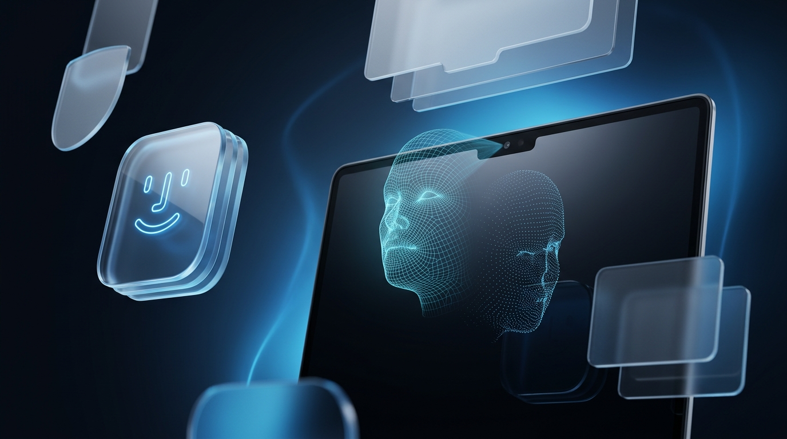
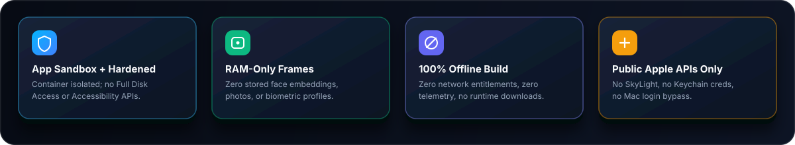
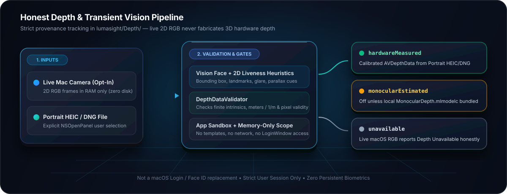

<div align="center">
  

  <br /><br />

  

  <h1>lumasight</h1>

  <p>
    <strong>App-Sandboxed macOS Notch Overlay, Transient Vision Demo &amp; Honest Depth Inspector</strong>
  </p>

  <p>
    <a href="LICENSE"></a>
    
    
    
    
  </p>

  <p>
    <a href="#-safe-installation-guide">Safe Install</a> •
    <a href="#-security--privacy-architecture">Security Model</a> •
    <a href="#-honest-depth--vision-lab">Vision &amp; Depth Lab</a> •
    <a href="#-verify-before-running">Verify Binary</a> •
    <a href="#-standalone-self-tests">Self-Tests</a>
  </p>
</div>

<br />

**lumasight** is a **100% offline, App-Sandboxed macOS utility** for experimenting with Apple `Vision` face detection, experimental 2D liveness heuristics, provenance-explicit depth inspection, and a customizable active-session notch/pill overlay strictly inside your signed-in user session.

> [!IMPORTANT]
> **macOS Platform Boundary — Not a Mac Unlock or Face ID Replacement**
>
> macOS provides **no supported public API** for a third-party webcam app to authenticate a user at the macOS login or lock screen.
>
> - lumasight **does not** unlock macOS, bypass FileVault/`LoginWindow`, or draw over the lock screen.
> - lumasight **does not** collect, store, decrypt, validate, or inject your macOS account password.
> - lumasight **does not** enroll face profiles, compute identity embeddings, store biometric templates, or treat 2D liveness cues or estimated depth as authentication.
> - No code review or automated test suite can prove any software is completely free of defects or vulnerabilities — inspect the entitlements and build from source below to verify every claim yourself.

---

## 🧊 Security & Privacy Architecture

<div align="center">
  
</div>

<br />

lumasight enables **App Sandbox** (`ENABLE_APP_SANDBOX = YES`) and **Hardened Runtime** (`ENABLE_HARDENED_RUNTIME = YES`) and uses only documented public Apple frameworks:

| Capability / Entitlement | Status | Exact Scope & Guarantee |
|---|---|---|
| **App Sandbox** (`com.apple.security.app-sandbox`) | **Enabled** | Isolates runtime preferences and container storage; zero arbitrary filesystem access. |
| **Camera** (`com.apple.security.device.camera`) | **Opt-in / On-demand** | Requested only when you explicitly start a camera preview, local presence demo, or Vision Lab. Live frames remain transiently in RAM and capture tears down immediately on stop, disconnect, or leaving the view. |
| **User-Selected Files** (`com.apple.security.files.user-selected.read-write`) | **`NSOpenPanel` Only** | Used solely when you explicitly pick legacy `glance` cleanup files or a Portrait photo (`HEIC`/`DNG`) to inspect embedded `AVDepthData`. Zero background disk scanning, no Full Disk Access. |
| **LocalAuthentication** (`LAContext`) | **Optional** | Gates only lumasight's own **Settings** window via Touch ID, Apple Watch, or system passcode when enabled in **Settings → Privacy**. |
| **Accessibility / Input Monitoring / Screen Recording / Mic** | **Not Used** | Zero keystroke injection, zero global event taps, zero audio capture. |
| **Keychain Access Groups / Passwords** | **Removed** | Unused since lumasight stores no passwords or session keys. |
| **Network / Telemetry / Auto-Updater** | **Not Used** | Zero network entitlements; Sparkle removed cleanly. [`UpdaterController`](lumasight/Updater/UpdaterController.swift) is offline and opens the GitHub releases page only on explicit click. |
| **Private `SkyLight` / `IOKit` HID** | **Removed** | Dynamic private symbol loading, lock-screen window levels, and HID wake monitors have been removed. |

---

## 💠 Honest Depth & Vision Lab

<div align="center">
  
</div>

<br />

- **Active-Session Presence Demo (Opt-in)**: Disabled by default. When explicitly enabled and triggered, runs a bounded (3–10s) transient `Vision` face-detection check in RAM (zero identity matching, zero stored embeddings) and animates an active-session `NSPanel` overlay ([`NotchOverlayController`](lumasight/NotchOverlay/NotchOverlayController.swift)) at the notch or top center.
- **Vision & Depth Lab** (reveal in **Settings → About** by tapping the app icon **5 times**):
  - Shows a live `Camera Active` badge, transient `Vision` face bounding box, landmarks availability, and head pose.
  - Exposes experimental 2D liveness cues (glare, bezel overlap, planar parallax heuristic, nose-yaw offset, blink) strictly labeled as non-security visualizations that cannot prove 3D geometry.
  - **Depth Provenance Model ([`lumasight/Depth/`](lumasight/Depth/))**:
    - `hardwareMeasured`: Validated `AVDepthData` + `AVCameraCalibrationData` with positive finite pixels and valid intrinsics (`meters` or `1/m`). Because macOS AppKit marks live depth capture (`AVCaptureDepthDataOutput`, `AVCaptureDevice.supportedDepthDataFormats`) `API_UNAVAILABLE(macos)` and Mac built-in cameras deliver 2D RGB video only, live capture reports `Depth Unavailable` honestly instead of fabricating 3D depth. You can inspect genuine `hardwareMeasured` depth embedded in user-selected Portrait `HEIC`/`DNG` photos via `ImageIO` (`NSOpenPanel`).
    - `monocularEstimated`: Disabled unless a licensed local Core ML model (`MonocularDepth.mlmodelc`) is explicitly bundled. lumasight never downloads models at runtime and always marks monocular estimates as non-metric relative visualizations.
    - `unavailable`: Explicit, inspectable reasons (`unsupportedPlatformLiveStreaming`, missing depth hardware, permission denied/restricted, missing calibration, desynchronized timestamps, invalid pixels, or camera disconnected).

---

## 🛡️ Safe Installation Guide

The safest way to install **lumasight** on your Mac is to **inspect the entitlements and build directly from source in Xcode** — so you know the exact binary running on your machine matches this repository, with zero network entitlements and full App Sandbox enforcement.

### Prerequisites

- **macOS 15 Sequoia** or newer
- **Xcode 26+** installed from the Mac App Store or Apple Developer portal (required for app bundling, `lumasighticon.icon` Icon Composer compilation, SwiftUI macros, and `GENERATE_INFOPLIST_FILE`)
- An Apple ID / Apple Developer team configured in Xcode (**Xcode → Settings → Accounts**) for local signing

### Step 1 — Clone the Repository & Inspect Entitlements

```bash
git clone https://github.com/techashutosh03/lumasight.git
cd lumasight
cat lumasight/lumasight.entitlements
```

Verify the entitlements file contains **only** these three keys:
- `com.apple.security.app-sandbox` (`true`)
- `com.apple.security.device.camera` (`true`)
- `com.apple.security.files.user-selected.read-write` (`true`)

### Step 2 — Optional Offline Logic Self-Test (Before Opening Xcode)

You can compile and run the camera-free liveness and geometry unit tests using standard Swift Command Line Tools (`swiftc`) without granting any permissions:

```bash
swiftc -O -o /tmp/liveness_selftest \
  lumasight/Liveness/LandmarkGeometry.swift \
  lumasight/Liveness/GeometryLiveness.swift \
  lumasight/Liveness/GlareCue.swift \
  lumasight/Liveness/LivenessCues.swift \
  lumasight/Liveness/LivenessScoring.swift \
  lumasight/Liveness/LivenessAnalyzer.swift \
  tools/liveness_selftest.swift && /tmp/liveness_selftest
```

### Step 3 — Build & Sign Safely in Xcode

1. Open `lumasight.xcodeproj` in **Xcode 26+**:
   ```bash
   open lumasight.xcodeproj
   ```
2. Select the **`lumasight`** project in the navigator → select the **`lumasight`** target → open **Signing & Capabilities**.
3. Under **Signing**, keep **Automatically manage signing** enabled and choose your own **Team** (a free personal Apple ID team works for running locally on your own Mac).
4. Confirm both **App Sandbox** (`Camera` + `User Selected File: Read/Write`) and **Hardened Runtime** remain enabled.
5. Select **Product → Run (`Cmd + R`)** to run immediately, or **Product → Archive** (or `Release` build) to export `lumasight.app` and drag it into `/Applications`.

<details>
<summary><strong>Optional: Build a Release `.app` from Terminal (when Xcode 26+ is active)</strong></summary>

```bash
sudo xcode-select -s /Applications/Xcode.app/Contents/Developer
xcodebuild -project lumasight.xcodeproj \
  -scheme lumasight \
  -configuration Release \
  -derivedDataPath ./build \
  build
```

The compiled app will be at `./build/Build/Products/Release/lumasight.app`.

</details>

### Step 4 — Verify Before Running

After building (or if installing a signed release archive from [Releases](https://github.com/techashutosh03/lumasight/releases)), verify the signature, sandbox entitlements, and `Info.plist` usage description:

```bash
codesign -dv --verbose=4 /Applications/lumasight.app
codesign -d --entitlements - /Applications/lumasight.app
plutil -p /Applications/lumasight.app/Contents/Info.plist
```

Confirm before granting any permissions:
- `codesign` verifies cleanly with no tampering.
- Entitlements show `app-sandbox`, `device.camera`, and `files.user-selected.read-write` **only** (no network, no accessibility, no keychain access groups).
- On first launch, **Camera permission is optional** — you can click **Skip** during onboarding and explore Settings safely without enabling the camera until you choose to test a preview or Vision Lab.

> [!WARNING]
> **Gatekeeper & Third-Party Downloads**
>
> Never run `xattr -cr` or bypass macOS Gatekeeper on an unverified binary downloaded from unknown sources. If you do not see an Apple-notarized release on the official [Releases](https://github.com/techashutosh03/lumasight/releases) page, build directly from source using Steps 1–4 above.

---

## 🧹 Legacy Data Migration & Clean Uninstall

Current versions of lumasight store **no passwords, no face embeddings, and no images**. Non-security preferences live in `UserDefaults` under bundle ID `com.jonathan.glance` (automatically migrating and deleting deprecated v1/v2 unlock keys on startup).

- **Upgrading from older `glance` builds**: Open **Settings → Privacy** to inspect and confirm deletion of legacy `encryptedPassword` / `sessionKey` Keychain items or `face-identities.*` files inside the container, or use **Select Items…** (`NSOpenPanel`) to clean older `~/Library/Application Support/glance/` files across the sandbox boundary.
- **Clean uninstall**:
  1. Quit **lumasight** from the menu bar icon (`Quit lumasight`) or Activity Monitor.
  2. Move `/Applications/lumasight.app` to the Trash.
  3. Optionally remove its sandbox container at `~/Library/Containers/com.jonathan.glance/` in Finder.

---

## 🧪 Standalone Self-Tests

- [`tools/liveness_selftest.swift`](tools/liveness_selftest.swift) — camera-free unit test for geometric planar-vs-3D separation and the experimental 2D liveness state machine (compiles directly with CommandLineTools `swiftc`; see [`tools/README.md`](tools/README.md)).
- [`tests/lumasight_security_tests.swift`](tests/lumasight_security_tests.swift) — covers settings migration/clamping, Keychain/file cleanup, honest failure reporting, user-guided cleanup boundaries, camera permission/denial/cancellation/teardown, transient zero-persistence demo, depth provenance/calibration/sync/validation, display/shape guards, and onboarding guardrails (requires Xcode's `SwiftUIMacros` plugin when compiling against SwiftUI overlay views).

---

## ⚠️ Known Limitations & Residual Risks

- **No authentication guarantee**: lumasight is an educational UI & local vision sandbox utility, not a security or authentication factor.
- **macOS live depth limitation**: Native macOS `AVCaptureSession` APIs do not support live `AVCaptureDepthDataOutput` streaming, and Mac built-in cameras lack hardware depth sensors.
- **Settings App Lock scope**: `LocalAuthentication` gates only the Settings UI in memory; rely on macOS FileVault and user account separation to protect disk state.
- **Manual updates only**: Without an in-app updater or network entitlements, users pull/build updates manually from [Releases](https://github.com/techashutosh03/lumasight/releases).

---
Released under the [MIT License](LICENSE).
